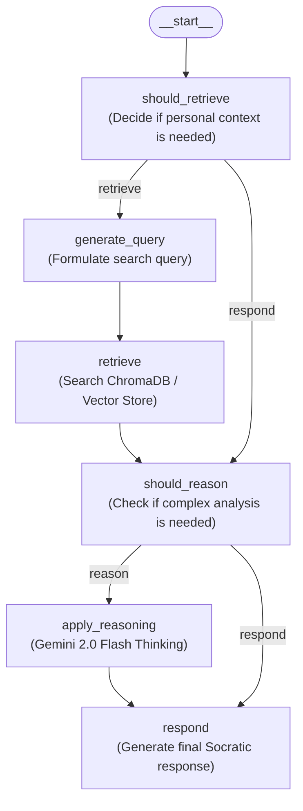

# Mirror Agent - Your AI Guide to Self-Reflection

Mirror Agent is an AI companion designed to help you understand yourself better through guided introspection and meaningful dialogue. Built on **LangGraph**, **LangChain**, **ChromaDB**, and **Mem0**, it combines Socratic questioning, persistent long-term memory, personal document retrieval (e.g., Obsidian notes), and multi-step reasoning.

---

## Expérimentation de ce Fork : Amélioration par l'IA *Sans Exécution* (Zero-Runtime QA)

> [!NOTE]
> **Philosophie & Objectif de cette démarche**
> Ce dépôt a été amélioré **sans jamais lancer l'application**. L'objectif est d'expérimenter l'amélioration incrémentale d'une base de code existante par l'IA uniquement par **analyse théorique**, lecture des contrats de types, inspection de l'historique Git et vérification statique.
>
> **La question centrale :**
> *« Sans équipe de QA humaine, est-il actuellement possible pour une personne solo de vérifier et garantir que le code amélioré par l'IA est fonctionnel et robuste, sans exécuter le système complet et sans devoir superviser l'IA à 100 % ? »*

### Comment valider la théorie sans lancer l'application ?
1. **Analyse des invariants et des types** : Identifier les erreurs qui se produiraient à l'exécution par simple lecture des définitions (ex. découvrir que `AnyMessage` dans `langchain_core.messages` est un `typing.Union` non instanciable et non une classe concrète).
2. **Corrélation entre gestion d'exceptions et assertions de tests** : Comprendre pourquoi un `try...except Exception:` trop large masque un `TypeError` interne en retournant `[]`, ce qui déplace le symptôme vers un échec d'assertion (`AssertionError`) plus loin dans les tests.
3. **Conformité aux règles d'analyse statique** : Vérifier que le code respecte les contraintes du projet (`py_compile`, typage, règles Ruff comme `T201` interdisant `print()`) sans avoir besoin de clés API ni d'infrastructure active.

---

## Architecture & Workflow

Instead of a single monolithic script, Mirror Agent is structured as two **LangGraph** state graphs configured in [`langgraph.json`](./langgraph.json):

1. **`retrieval_graph` ([`src/retrieval_graph/graph.py`](./src/retrieval_graph/graph.py))**: The main conversational and reasoning pipeline.
2. **`indexer` ([`src/retrieval_graph/index_graph.py`](./src/retrieval_graph/index_graph.py))**: The document ingestion pipeline.



### Key Components
- [`src/retrieval_graph/graph.py`](./src/retrieval_graph/graph.py): Conditional routing between retrieval, reasoning (`gemini-2.0-flash-thinking-exp-01-21`), and response generation (`openai/gpt-4o`).
- [`src/retrieval_graph/state.py`](./src/retrieval_graph/state.py): Graph state management (`State`, `InputState`, `IndexState`) backed by Mem0 reducers (`reduce_messages`, `reduce_docs`).
- [`src/retrieval_graph/mem0_client.py`](./src/retrieval_graph/mem0_client.py): Client wrapper around `mem0.ai` for storing and retrieving user memories, messages, and documents.
- [`utils/obsidian_monitor.py`](./utils/obsidian_monitor.py) & [`utils/obsidian_indexer.py`](./utils/obsidian_indexer.py): Automatic monitoring and indexing of local Obsidian markdown notes into ChromaDB.

---

## Getting Started (Setup & First Launch)

> [!IMPORTANT]
> **No `main.py` file**: Earlier documentation referenced `python main.py`, which does not exist in this repository. Because this project is a **LangGraph** application defined in [`langgraph.json`](./langgraph.json), it is launched via the **LangGraph CLI (`langgraph dev`)** or tested via `pytest` / `unittest`.

### 1. Create a Virtual Environment & Install Dependencies

```powershell
# Clone your fork
git clone https://github.com/brandonviry/mirror-agent.git
cd mirror-agent

# Create and activate virtual environment
python -m venv .venv
# Windows (PowerShell):
.\.venv\Scripts\Activate.ps1
# macOS / Linux:
source .venv/bin/activate

# Install the package in editable mode with required tools
pip install -e .
pip install mem0ai "langgraph-cli[inmem]" pytest
```

### 2. Configure Environment Variables (`.env`)

Copy [`.env.example`](./.env.example) to `.env` and fill in your credentials:

```powershell
Copy-Item .env.example .env
```

| Variable | Required | Description |
| :--- | :---: | :--- |
| `OPENAI_API_KEY` | Yes | Used by default for `query_model` and `response_model` (`openai/gpt-4o`) |
| `GOOGLE_API_KEY` | If reasoning | Used by `apply_reasoning` (`gemini-2.0-flash-thinking-exp-01-21`) |
| `MEM0_API_KEY` | Yes | Your [mem0.ai](https://mem0.ai) API key |
| `MEM0_ORG_ID` | Yes | Your Mem0 Organization ID |
| `MEM0_PROJECT_ID` | Yes | Your Mem0 Project ID |
| `MEM0_USER_ID` | **Yes (at import)** | Unique user ID (e.g., `test-user`). Checked immediately when `Mem0Memory` initializes |
| `MEM0_APP_ID` | Optional | Defaults to `mirror-agent` |
| `MEM0_RUN_ID` | Optional | Defaults to `test-run` |

### 3. Launch or Test the Project

**Option A — Launch with LangGraph Studio / Dev Server:**
```powershell
langgraph dev
```

**Option B — Run Static Verification & Unit Tests:**
```powershell
# Syntax & compilation check (no API keys required)
python -m py_compile src/retrieval_graph/mem0_client.py

# Unit tests
pytest tests/unit_tests

# Mem0 integration tests (requires valid MEM0_* keys in .env)
python -m unittest tests/test_mem0_integration.py
```

---

## Code Improvements: `mem0_client.py` Refactoring

In [`src/retrieval_graph/mem0_client.py`](./src/retrieval_graph/mem0_client.py), `get_messages()` and `get_documents()` were refactored to fix critical runtime and testing issues:

1. **Fixed `AnyMessage` Instantiation Bug (`TypeError: Cannot instantiate typing.Union`)**:
   - *Before*: `get_messages()` called `AnyMessage(content=..., type=..., additional_kwargs=...)`. In `langchain_core.messages`, `AnyMessage` is a `typing.Union` type alias, **not** an instantiable class. When wrapped in a broad `try...except`, the `TypeError` was silently caught and `get_messages()` always returned `[]`, causing test assertions (`self.assertTrue(...)` in [`tests/test_mem0_integration.py`](./tests/test_mem0_integration.py)) to fail.
   - *After*: Mapped `metadata["message_type"]` via `MESSAGE_TYPES` to concrete LangChain message classes (`HumanMessage`, `AIMessage`, `SystemMessage`).

2. **Granular Error Isolation (Storage vs. Item Parsing)**:
   - *Before*: A single `try...except` block wrapped both `self.get_memories(...)` and the entire `for memory in memories:` loop. A single malformed entry aborted the loop.
   - *After*: Network/API failures in `self.get_memories(...)` are caught separately from per-item parsing errors, so a single corrupted memory entry is skipped without losing the rest of the conversation history.

3. **Structured Logging instead of `print()` (Ruff `T201` Compliance)**:
   - *Before*: Used `print(f"Error retrieving messages: {e}")`, which violated the project's Ruff `T201` (`flake8-print`) rule in [`pyproject.toml`](./pyproject.toml) and discarded the stack trace.
   - *After*: Uses `logger.exception(...)` and `logger.warning(...)` from Python's standard `logging` module.

4. **Null-Safe Metadata & Payload Extraction**:
   - *Before*: `memory.get("metadata", {}).get(...)` raised `AttributeError` if `"metadata"` existed in the dictionary with a value of `None`.
   - *After*: Explicitly validates `isinstance(metadata, dict)` and supports both `"text"` and `"memory"` payload keys.

---

## Core Features

- **Model-Agnostic Architecture**: Choose your preferred LLM backend (`openai`, `anthropic`, `fireworks`, `google`).
- **Memory System**: Persistent long-term memory via Mem0.
- **Document Integration**: References personal documents and Obsidian vaults via ChromaDB.
- **Reflective Intelligence**: Identifies patterns and insights using dedicated reasoning models.

## Credits

Originally created by [@daniel_mac8](https://twitter.com/daniel_mac8).
