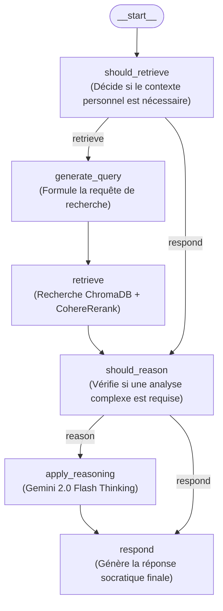

# Mirror Agent — Votre Guide IA pour l'Introspection

**Mirror Agent** est un compagnon IA conçu pour vous aider à mieux vous comprendre grâce à une introspection guidée et un dialogue socratique. Construit avec **LangGraph**, **LangChain**, **ChromaDB** et **Mem0**, il combine questionnement socratique, mémoire persistante à long terme, recherche dans vos documents personnels (ex. notes Obsidian) et raisonnement analytique multi-étapes.

---

## Expérimentation de ce Fork : Amélioration par l'IA *Sans Exécution* (Zero-Runtime QA)

> [!NOTE]
> **Philosophie & Objectif de cette démarche**
> Ce dépôt a été amélioré **sans jamais lancer l'application**. L'objectif est d'expérimenter l'amélioration incrémentale d'une base de code existante par l'IA uniquement par **analyse théorique**, lecture des contrats de types, inspection de l'historique Git et vérification statique.
>
> **La question centrale :**
> *« Sans équipe de QA humaine, est-il actuellement possible pour une personne solo de vérifier et garantir que le code amélioré par l'IA est fonctionnel et robuste, sans exécuter le système complet et sans devoir superviser l'IA à 100 % ? »*

### Comment valider la théorie sans lancer l'application ?
1. **Analyse des invariants et des types** : Identifier les erreurs qui se produiraient à l'exécution par simple lecture des définitions (ex. découvrir que `AnyMessage` dans `langchain_core.messages` est un `typing.Union` non instanciable et non une classe concrète).
2. **Corrélation entre gestion d'exceptions et assertions de tests** : Comprendre pourquoi un `try...except Exception:` trop large masque un `TypeError` interne en retournant `[]`, ce qui déplace le symptôme vers un échec d'assertion (`AssertionError`) plus loin dans les tests.
3. **Conformité aux règles d'analyse statique** : Vérifier que le code respecte les contraintes du projet (`py_compile`, typage, règles Ruff comme `T201` interdisant `print()`) sans avoir besoin de clés API ni d'infrastructure active.

---

## Architecture & Flux d'Exécution

Plutôt qu'un script monolithique unique, Mirror Agent est structuré autour de deux graphes d'état **LangGraph** déclarés dans [`langgraph.json`](./langgraph.json) :

1. **`retrieval_graph` ([`src/retrieval_graph/graph.py`](./src/retrieval_graph/graph.py))** : Le pipeline principal de conversation, de recherche documentaire et de raisonnement.
2. **`indexer` ([`src/retrieval_graph/index_graph.py`](./src/retrieval_graph/index_graph.py))** : Le pipeline d'ingestion et d'indexation des documents.



### Composants Clés
- [`src/retrieval_graph/graph.py`](./src/retrieval_graph/graph.py) : Routage conditionnel entre la recherche documentaire, le raisonnement analytique (`gemini-2.0-flash-thinking-exp-01-21`) et la génération de réponse (`openai/gpt-4o`).
- [`src/retrieval_graph/state.py`](./src/retrieval_graph/state.py) : Gestion de l'état du graphe (`State`, `InputState`, `IndexState`) persisté via les réducteurs Mem0 (`reduce_messages`, `reduce_docs`).
- [`src/retrieval_graph/mem0_client.py`](./src/retrieval_graph/mem0_client.py) : Client autour de `mem0.ai` (`Mem0Memory`) pour stocker et récupérer les souvenirs, messages et documents de l'utilisateur.
- [`src/retrieval_graph/retrieval.py`](./src/retrieval_graph/retrieval.py) : Création dynamique du retriever (ChromaDB par défaut avec embeddings `BAAI/bge-large-en-v1.5` mis en cache et compression contextuelle `CohereRerank`, ainsi que le support d'Elasticsearch, Pinecone et MongoDB).
- [`utils/obsidian_monitor.py`](./utils/obsidian_monitor.py) & [`utils/obsidian_indexer.py`](./utils/obsidian_indexer.py) : Surveillance et indexation automatiques des notes Markdown Obsidian locales dans ChromaDB.

### Documentation du Projet (`docs/`)
- [`docs/project_plan.md`](./docs/project_plan.md) : Plan de projet complet, architecture et suivi des phases.
- [`docs/o1_architecture.md`](./docs/o1_architecture.md) : Schéma d'architecture détaillé des flux `RetrievalGraph` et `IndexGraph`.
- [`docs/mem0ai-llm-summary.md`](./docs/mem0ai-llm-summary.md) : Guide d'utilisation et spécifications du client `Mem0Memory`.
- [`docs/jxnl_co_writing_2024_05_22_systematically-improving-your-rag__docs.md`](./docs/jxnl_co_writing_2024_05_22_systematically-improving-your-rag__docs.md) : Synthèse en français des méthodes d'amélioration systématique d'un pipeline RAG.
- [`docs/weave-docs_wandb_ai__docs.md`](./docs/weave-docs_wandb_ai__docs.md) : Documentation de Weave (Weights & Biases) utilisé pour l'évaluation RAG (`utils/eval_rag_pipeline.py`).

---

## Démarrage Rapide (Installation & Lancement)

> [!IMPORTANT]
> **Absence de fichier `main.py`** : Les anciennes versions de la documentation mentionnaient `python main.py`, qui n'existe pas dans ce dépôt. Ce projet étant une application **LangGraph** définie dans [`langgraph.json`](./langgraph.json), il se lance via le **CLI LangGraph (`langgraph dev`)** ou se vérifie via `pytest` / `unittest`.

### 1. Créer un Environnement Virtuel & Installer les Dépendances

```powershell
# Cloner le fork
git clone https://github.com/brandonviry/mirror-agent.git
cd mirror-agent

# Créer et activer l'environnement virtuel
python -m venv .venv
# Windows (PowerShell) :
.\.venv\Scripts\Activate.ps1
# macOS / Linux :
source .venv/bin/activate

# Installer le paquet en mode éditable ainsi que les outils requis
pip install -e .
pip install mem0ai "langgraph-cli[inmem]" pytest
```

### 2. Configurer les Variables d'Environnement (`.env`)

Copiez [`.env.example`](./.env.example) vers `.env` et renseignez vos clés API :

```powershell
Copy-Item .env.example .env
```

| Variable | Obligatoire | Description |
| :--- | :---: | :--- |
| `OPENAI_API_KEY` | Oui | Utilisée par défaut pour `query_model` et `response_model` (`openai/gpt-4o`) |
| `GOOGLE_API_KEY` | Si raisonnement | Utilisée par `apply_reasoning` (`gemini-2.0-flash-thinking-exp-01-21`) |
| `MEM0_API_KEY` | Oui | Votre clé API [mem0.ai](https://mem0.ai) |
| `MEM0_ORG_ID` | Oui | Votre identifiant d'organisation Mem0 |
| `MEM0_PROJECT_ID` | Oui | Votre identifiant de projet Mem0 |
| `MEM0_USER_ID` | **Oui (à l'import)** | Identifiant unique de l'utilisateur (ex. `test-user`). Vérifié dès l'initialisation de `Mem0Memory` |
| `MEM0_APP_ID` | Optionnel | Valeur par défaut : `mirror-agent` |
| `MEM0_RUN_ID` | Optionnel | Valeur par défaut : `test-run` |
| `COHERE_API_KEY` | Optionnel | Utilisée par `CohereRerank` (`rerank-english-v3.0`) pour la compression contextuelle |

### 3. Lancer ou Tester le Projet

**Option A — Lancer avec LangGraph Studio / Serveur de Développement :**
```powershell
langgraph dev
```

**Option B — Exécuter la Vérification Statique & les Tests Unitaires :**
```powershell
# Vérification syntaxique et compilation (aucune clé API requise)
python -m py_compile src/retrieval_graph/mem0_client.py

# Tests unitaires
pytest tests/unit_tests

# Tests d'intégration Mem0 (nécessite des clés MEM0_* valides dans .env)
python -m unittest tests/test_mem0_integration.py
```

---

## Améliorations du Code : Refactoring de `mem0_client.py`

Dans [`src/retrieval_graph/mem0_client.py`](./src/retrieval_graph/mem0_client.py), les méthodes `get_messages()` et `get_documents()` ont été refactorisées afin de corriger plusieurs problèmes critiques d'exécution et de testabilité :

1. **Correction du Bug d'Instanciation `AnyMessage` (`TypeError: Cannot instantiate typing.Union`)** :
   - *Avant* : `get_messages()` appelait `AnyMessage(content=..., type=..., additional_kwargs=...)`. Dans `langchain_core.messages`, `AnyMessage` est un alias de type `typing.Union` et **non** une classe instanciable. Englobée dans un `try...except` générique, l'exception `TypeError` était silencieusement capturée et `get_messages()` retournait systématiquement `[]`, faisant échouer les assertions de [`tests/test_mem0_integration.py`](./tests/test_mem0_integration.py).
   - *Après* : Association de `metadata["message_type"]` via le dictionnaire `MESSAGE_TYPES` vers les classes concrètes de LangChain (`HumanMessage`, `AIMessage`, `SystemMessage`).

2. **Isolation Granulaire des Erreurs (Stockage vs Parsing d'un Élément)** :
   - *Avant* : Un seul bloc `try...except` entourait à la fois l'appel réseau `self.get_memories(...)` et toute la boucle `for memory in memories:`. Une seule entrée malformée interrompait la récupération de tout l'historique.
   - *Après* : Les erreurs réseau/API de `self.get_memories(...)` sont capturées séparément des erreurs de parsing propres à chaque entrée, permettant d'ignorer un élément corrompu sans perdre le reste de la conversation.

3. **Journalisation Structurée au lieu de `print()` (Conformité Ruff `T201`)** :
   - *Avant* : Utilisait `print(f"Error retrieving messages: {e}")`, ce qui enfreignait la règle Ruff `T201` (`flake8-print`) configurée dans [`pyproject.toml`](./pyproject.toml) et masquait la trace d'exécution (stack trace).
   - *Après* : Utilise `logger.exception(...)` et `logger.warning(...)` via le module standard `logging` de Python.

4. **Extraction Défensive des Métadonnées et du Contenu (`Null-Safe`)** :
   - *Avant* : `memory.get("metadata", {}).get(...)` levait une `AttributeError` si la clé `"metadata"` était présente dans le dictionnaire avec la valeur `None`.
   - *Après* : Vérifie explicitement `isinstance(metadata, dict)` et prend en charge les clés de contenu `"text"` et `"memory"`.

---

## Fonctionnalités Principales

- **Architecture Indépendante du Modèle** : Choisissez votre fournisseur LLM préféré (`openai`, `google`, `anthropic`, `fireworks`).
- **Système de Mémoire Persistante** : Mémoire à long terme gérée via Mem0 (`mem0.ai`).
- **Intégration Documentaire & Obsidian** : Indexation et interrogation de vos notes personnelles via ChromaDB et re-ranking Cohere.
- **Intelligence Réflexive** : Identification des schémas de pensée et décomposition analytique via des modèles de raisonnement dédiés (`Gemini 2.0 Flash Thinking`).

## Crédits

Créé originellement par [@daniel_mac8](https://twitter.com/daniel_mac8).
