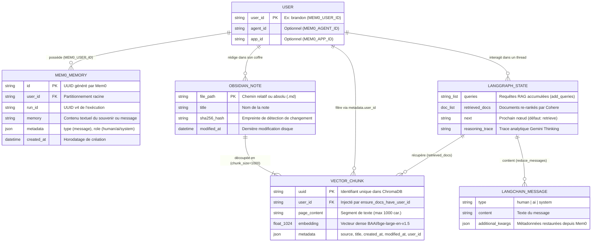

import { Callout } from 'fumadocs-ui/components/callout';

# Données, Schémas & Modèles Entité-Relation

Cette page couvre le **Niveau 5 (Données, Schémas & Stockage)** de l'architecture de **Mirror Agent**.

Le système manipule et persiste ses données à travers **trois couches de stockage complémentaires** :
1. **L'État d'Exécution LangGraph (`src/retrieval_graph/state.py`)** : dataclasses typées en mémoire vive (`InputState`, `State`, `IndexState`) gouvernées par des fonctions de réduction (*reducers*).
2. **La Mémoire Épisodique à Long Terme (`Mem0` — `src/retrieval_graph/mem0_client.py`)** : stockage cloud (ou auto-hébergé) des messages, faits biographiques et souvenirs associés à un `user_id`.
3. **La Base Vectorielle Documentaire (`ChromaDB` par défaut — `src/retrieval_graph/retrieval.py`)** : stockage local sur disque (`./data/chroma`) des notes Markdown d'Obsidian découpées en chunks et vectorisées en 1024 dimensions.

---

## 1. Modèle Entité-Relation Global (`erDiagram`)

Le diagramme ci-dessous illustre les relations cardinales entre l'utilisateur, ses sessions LangGraph, ses souvenirs Mem0 et les chunks vectoriels issus de son coffre Obsidian :



---

## 2. Couche 1 : Schémas d'État LangGraph (`src/retrieval_graph/state.py`)

LangGraph orchestre les transitions entre nœuds en faisant circuler un état typé sous forme de `@dataclass`. Chaque champ annoté avec `Annotated[Type, reducer_fn]` délègue sa règle de fusion au *reducer* spécifié.

### 2.1. `IndexState` (Graphe d'Indexation)

Utilisé par `index_graph` (`src/retrieval_graph/index_graph.py`) pour recevoir et normaliser les lots de documents à indexer.

| Champ | Type Python | Reducer | Défaut | Rôle et Comportement |
| :--- | :--- | :--- | :--- | :--- |
| **`docs`** | `Sequence[Document]` | `reduce_docs` | `list` (`[]`) | Convertit des entrées polymorphes (`Document`, `dict`, `str`, ou `"delete"`) en liste d'objets LangChain `Document` et les enregistre dans Mem0. |

### 2.2. `InputState` & `State` (Graphe Principal `RetrievalGraph`)

| Classe | Champ | Type Python | Reducer | Défaut | Description |
| :--- | :--- | :--- | :--- | :--- | :--- |
| **`InputState`** | `messages` | `Sequence[AnyMessage]` | `reduce_messages` | `list` (`[]`) | Historique conversationnel. À chaque nouveau message, `reduce_messages` appelle `mem0.add_message(new)` puis recharge `mem0.get_messages()`. |
| **`State`** | `queries` | `list[str]` | `add_queries` | `list` (`[]`) | Liste cumulative des requêtes de recherche générées par le LLM (`list(existing) + list(new)`). |
| **`State`** | `retrieved_docs` | `list[Document]` | Remplacement | `list` (`[]`) | Chunks documentaires issus de la base vectorielle et re-rankés par `CohereRerank`. |
| **`State`** | `next` | `str` | Remplacement | `"retrieve"` | Indicateur d'étape suivante dans le graphe. |
| **`State`** | `reasoning_trace` | `Optional[str]` | Remplacement | `None` | Trace de réflexion produite par le nœud `apply_reasoning` (`Gemini 2.0 Flash Thinking`). |

<Callout type="warn" title="Note sur l'héritage entre State et InputState">
Dans la version actuelle de `src/retrieval_graph/state.py` (`L147`), `State` ne déclare pas explicitement `class State(InputState):` (voir la fiche [**BUG-005**](/docs/bugs/bug-005-state-inheritance-messages)). LangGraph fusionne dynamiquement `InputState.messages` dans l'état lors d'un appel `graph.ainvoke({"messages": [...]})`.
</Callout>

---

## 3. Couche 2 : Schéma de Stockage Mem0 (`src/retrieval_graph/mem0_client.py`)

Le client `Mem0Memory` communique avec l'API REST de `mem0.ai` via `MemoryClient`.

### 3.1. Contrat JSON d'Écriture (`client.add`)

Contrairement aux anciennes versions du SDK, l'API v1 de Mem0 exige que les identifiants de partitionnement soient placés **à la racine** du dictionnaire envoyé (et jamais imbriqués sous `"filters"`) :

```json
{
  "text": "Je repousse souvent mes projets quand ils arrivent à 80 % d'avancement.",
  "user_id": "brandon",
  "run_id": "8f14e45f-ceea-467f-a8f8-17b568b07b1a",
  "metadata": {
    "type": "message",
    "role": "human",
    "additional_kwargs": {}
  }
}
```

### 3.2. Contrat JSON de Lecture (`client.get_all` / `client.search`)

Lors de la récupération des souvenirs (`get_messages`), l'API retourne une liste d'entrées normalisées par `Mem0Memory` via la table `MESSAGE_TYPES` :

| Valeur de `metadata.role` | Classe LangChain Instanciée | Comportement de Repli (*Fallback*) |
| :--- | :--- | :--- |
| `"human"` ou `"user"` | `HumanMessage(content=..., additional_kwargs=...)` | Valeur par défaut si `role` est absent ou inconnu |
| `"ai"` ou `"assistant"` | `AIMessage(content=..., additional_kwargs=...)` | — |
| `"system"` | `SystemMessage(content=..., additional_kwargs=...)` | — |

---

## 4. Couche 3 : Stockage Vectoriel & Chunks Documentaires

### 4.1. Structure Physique de ChromaDB (Défaut)

Par défaut (`retriever_provider="chroma"`), la base vectorielle est stockée localement dans `./data/chroma` :

| Paramètre | Valeur dans le Code (`retrieval.py` & `obsidian_indexer.py`) | Détails Techniques |
| :--- | :--- | :--- |
| **Répertoire de persistance** | `./data/chroma` (`CHROMA_PERSIST_DIR`) | Contient `chroma.sqlite3` (métadonnées et textes) + segment HNSW binaire |
| **Nom de la collection** | `"obsidian"` (`COLLECTION_NAME`) | Collection unique filtrée par `metadata.user_id` |
| **Modèle d'Embeddings** | `BAAI/bge-large-en-v1.5` | Vecteurs denses de **1024 dimensions**, normalisés (`normalize_embeddings=True`) |
| **Cache du modèle** | `~/.cache/mirror-agent` | Évite le re-téléchargement du modèle PyTorch (1,34 Go) |
| **Découpage (*Chunking*)** | `RecursiveCharacterTextSplitter` | `chunk_size=1000` caractères, `chunk_overlap=200` caractères |
| **Compression / Re-ranking** | `CohereRerank(model="rerank-english-v3.0")` | Re-classe les `k` candidats initiaux via `ContextualCompressionRetriever` |

### 4.2. Schéma d'un Document Indexé (`langchain_core.documents.Document`)

Chaque chunk stocké dans ChromaDB (ou Pinecone, Elasticsearch, MongoDB Atlas) respecte la structure suivante :

```json
{
  "page_content": "# Objectifs T4\nJe souhaite approfondir ma pratique de l'écriture réflexive...",
  "metadata": {
    "user_id": "brandon",
    "source": "2026-10-Objectifs.md",
    "title": "2026-10-Objectifs",
    "created_at": "2026-10-01T09:15:00",
    "modified_at": "2026-10-20T18:42:10"
  }
}
```

### 4.3. Format XML d'Injection dans le Prompt LLM (`format_docs`)

Avant d'être transmis aux modèles `gpt-4o` ou `gemini-2.0-flash-thinking-exp-01-21`, les documents récupérés (`state.retrieved_docs`) sont sérialisés en XML par `format_docs()` (`src/retrieval_graph/utils.py`) :

```xml
<documents>
  <document source="2026-10-Objectifs.md" title="2026-10-Objectifs" user_id="brandon">
    # Objectifs T4
    Je souhaite approfondir ma pratique de l'écriture réflexive...
  </document>
</documents>
```

Ce balisage XML permet aux prompts système (`RESPONSE_SYSTEM_PROMPT` et `CHECK_KNOWN_INFO_SYSTEM_PROMPT`) de distinguer sans ambiguïté le contexte documentaire factuel des instructions système et de la parole de l'utilisateur.
