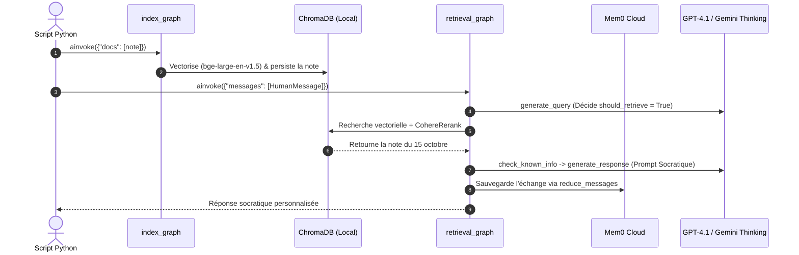

import { Callout } from 'fumadocs-ui/components/callout';
import { Steps, Step } from 'fumadocs-ui/components/steps';

Ce guide **Quick Start** vous permet de faire tourner **Mirror Agent** en moins de 5 minutes sur son cas d'usage principal : **indexer une note personnelle et engager un dialogue d'introspection socratique**.

<Callout type="info" title="Besoin d'un guide d'installation exhaustif ?">
Pour le détail complet des prérequis système, des variables optionnelles et du dépannage, consultez la page [Installation & Configuration détaillée](/docs/installation).
</Callout>

---

## 1. Installation Express (3 étapes)

<Steps>
<Step>
### Cloner le dépôt et activer l'environnement virtuel

```powershell
git clone https://github.com/brandonviry/mirror-agent.git
cd mirror-agent

python -m venv .venv
.\.venv\Scripts\Activate.ps1   # Linux / macOS : source .venv/bin/activate
pip install -e .
```
</Step>

<Step>
### Configurer le fichier `.env` minimal

Créez un fichier `.env` à la racine du projet avec les variables minimales requises par le pipeline par défaut :

```bash
# Identifiants Mem0 (Obligatoires dès l'import de retrieval_graph — voir BUG-004)
MEM0_API_KEY="m0-votre-cle"
MEM0_USER_ID="mon-profil-local"

# Modèles LLM & Re-ranking (Configuration par défaut)
OPENAI_API_KEY="sk-votre-cle-openai"
GOOGLE_API_KEY="votre-cle-google-gemini"
COHERE_API_KEY="votre-cle-cohere"
```
</Step>

<Step>
### Vérifier l'installation (Sans consommer de crédits API)

Avant même d'appeler un LLM externe, validez que le package et le client mémoire sont opérationnels :

```powershell
python -m pytest tests/unit_tests -v
```
</Step>
</Steps>

---

## 2. Cas d'Usage Principal : Exemple de Code Python Court

Le cœur de **Mirror Agent** repose sur deux graphes LangGraph complémentaires :
1. **`index_graph`** (`src/retrieval_graph/index_graph.py`) : découpe, vectorise (`BAAI/bge-large-en-v1.5`) et enregistre vos notes personnelles dans **ChromaDB** (`./data/chroma`).
2. **`retrieval_graph`** (`src/retrieval_graph/graph.py`) : analyse votre message, recherche dans vos notes + votre mémoire **Mem0**, applique un raisonnement analytique si nécessaire, et vous répond par un **questionnement socratique**.

Créez un fichier `demo_quickstart.py` (ou exécutez-le dans un notebook) :

```python
import asyncio
import os
from dotenv import load_dotenv

# 1. Charger les variables d'environnement (.env) AVANT d'importer retrieval_graph
load_dotenv()
os.environ.setdefault("MEM0_USER_ID", "demo-user")

from langchain_core.documents import Document
from langchain_core.messages import HumanMessage
from retrieval_graph.index_graph import graph as index_graph
from retrieval_graph.graph import graph as retrieval_graph


async def main() -> None:
    # --- ÉTAPE A : Indexer une note personnelle (ex: note Obsidian) ---
    note = Document(
        page_content=(
            "Journal du 15 octobre : J'ai remarqué que je repousse systématiquement "
            "le lancement de mes projets personnels dès qu'ils atteignent 80 % "
            "d'avancement, par peur du regard extérieur."
        ),
        metadata={"source": "journal/2026-10-15.md"},
    )
    await index_graph.ainvoke(
        {"docs": [note]},
        config={"configurable": {"user_id": os.environ["MEM0_USER_ID"]}},
    )
    print("✅ Note personnelle indexée dans ChromaDB.")

    # --- ÉTAPE B : Interroger Mirror Agent (Dialogue Socratique + RAG) ---
    question = (
        "Pourquoi est-ce que j'ai autant de mal à terminer mes projets "
        "alors que le plus dur est déjà fait ?"
    )
    result = await retrieval_graph.ainvoke(
        {"messages": [HumanMessage(content=question)]},
        config={"configurable": {"user_id": os.environ["MEM0_USER_ID"]}},
    )

    # --- ÉTAPE C : Afficher les sources retrouvées et la réponse socratique ---
    print(f"\n📚 Notes retrouvées : {len(result.get('retrieved_docs', []))}")
    print("\n🪞 Réponse de Mirror Agent :\n")
    print(result["messages"][-1].content)


if __name__ == "__main__":
    asyncio.run(main())
```

Exécutez le script :

```powershell
python demo_quickstart.py
```

### Que se passe-t-il sous le capot lors de cet appel ?



---

## 3. Usage Interactif avec LangGraph Studio (`langgraph dev`)

Si vous préférez une interface graphique complète permettant de visualiser chaque nœud traversé en temps réel :

```powershell
pip install -U "langgraph-cli[inmem]"
langgraph dev
```

Le serveur local démarre sur **`http://127.0.0.1:2024`** et expose directement les deux graphes déclarés dans [`langgraph.json`](https://github.com/brandonviry/mirror-agent/blob/main/langgraph.json) :
- **`indexer`** : pour injecter des documents JSON/Markdown.
- **`retrieval_graph`** : pour converser avec l'agent et inspecter l'état (`queries`, `retrieved_docs`, `messages`).

<Callout type="warn" title="Piège fréquent au premier lancement">
Si vous rencontrez une erreur `ValueError: MEM0_USER_ID must be set in the environment` dès l'import Python, vérifiez que `load_dotenv()` (ou `os.environ["MEM0_USER_ID"]`) est exécuté **avant** la ligne `from retrieval_graph.graph import graph`. Consultez la fiche [**BUG-004**](/docs/bugs/bug-004-state-import-crash) pour plus de détails.
</Callout>
